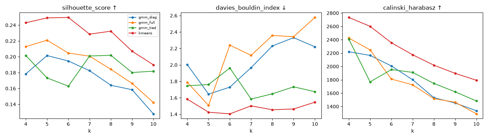
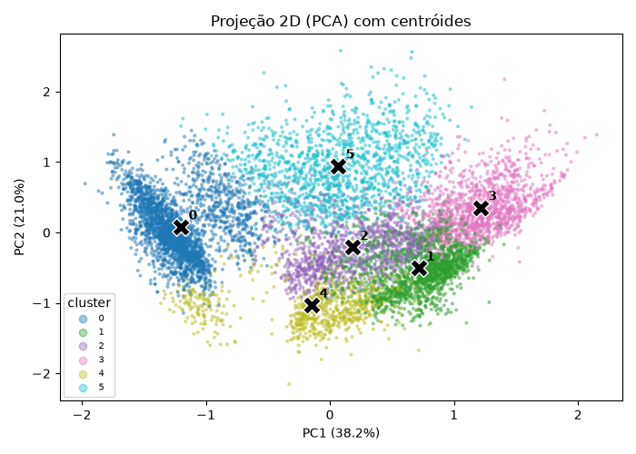
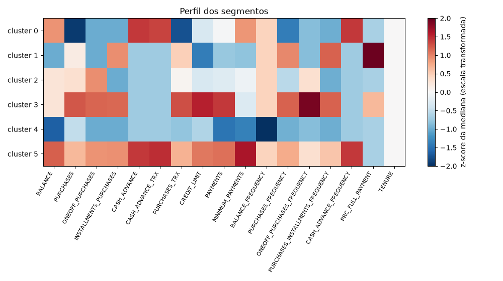
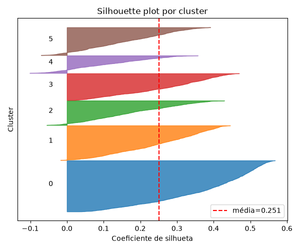

# 01 · Segmentação de clientes de cartão de crédito

**Script:** `p01_clustering/train.py` · **Experimento:** `01_clustering_credit_card` ·
**Modelo:** `credit_card_segmentation@champion`

## Objetivo

Agrupar clientes por padrão de uso do cartão para orientar estratégias de crédito personalizadas.

## Dados

Kaggle `arjunbhasin2013/ccdata` (`CC GENERAL.csv`): **8.950 clientes × 17 variáveis** (sem `CUST_ID`),
resumo de 6 meses de uso.

| Característica | Valor |
|---|---|
| Faltantes | `MINIMUM_PAYMENTS`: 313 · `CREDIT_LIMIT`: 1 |
| Assimetria | Monetárias (`BALANCE`, `PURCHASES`, `CASH_ADVANCE`, `PAYMENTS`...) com caudas longas e muitos zeros |
| Variáveis limitadas | `*_FREQUENCY` e `PRC_FULL_PAYMENT` em [0, 1] |
| Quase constante | `TENURE`: 84,7% dos clientes = 12 meses |

> O link original da tabela de projetos apontava para `arjunbhasin2008/ccdata`, que não existe (403).
> O dataset correto é `arjunbhasin2013/ccdata`.

## Pipeline

1. **Imputação pela mediana** (`SimpleImputer`).
2. **Yeo-Johnson só nas variáveis monetárias e de contagem.** As frequências já são limitadas a [0,1] e
   `TENURE` é quase constante. Aplicar Yeo-Johnson nelas gerava um λ extremo e valores da ordem de
   −10¹⁷ em `TENURE`, o que produzia uma silhueta artificial de 0,99 (ver
   [06](06_decisoes_e_correcoes.md#2-yeo-johnson-explodindo-tenure)).
3. **`RobustScaler(quantile_range=(5, 95))`**: com o IQR padrão (25–75), colunas concentradas
   ficariam com escala 0 e sem padronização.
4. **Varredura** k ∈ [k_min, 10]:
   - K-Means (`k-means++`, `n_init=10`);
   - GMM com covariância `full`, `diag` e `tied` (`n_init=3`, `reg_covar=1e-4`), com BIC e AIC.
5. **Seleção**: maior silhueta entre as soluções em que nenhum cluster tem menos de 3% dos clientes.
6. **Estabilidade**: o modelo escolhido é re-treinado com 5 outras seeds e comparado por ARI.
7. **Perfil**: medianas por cluster na escala original + heatmap em z-score.
8. O **pré-processamento + clusterizador** é registrado como um único `Pipeline` sklearn, que recebe o
   CSV bruto e devolve o segmento.

Cada combinação (algoritmo, covariância, k) é um run aninhado com `silhouette_score`,
`davies_bouldin_index`, `calinski_harabasz`, `min_cluster_frac` e `inertia` (K-Means) ou `bic`/`aic` (GMM).

## Execuções

Foram feitas duas execuções com os dados reais:

| Run | Varredura | Escolha | Silhueta | Davies-Bouldin | Calinski-Harabasz | ARI (estabilidade) |
|---|---|---|---|---|---|---|
| `4efc92ec…` | k = 2..10 | K-Means, k=2 | **0,278** | 1,397 | 3.681 | 1,000 |
| `73bfd090…` (**champion**) | k = 4..10 | K-Means, k=6 | 0,250 | 1,405 | 2.355 | 0,996 (mín. 0,993) |

**Por que a segunda execução:** a silhueta favorece k=2 neste dataset, mas a solução k=2 só separa
"quem compra" (63%) de "quem saca dinheiro no cartão" (37%), o que é pouco útil para estratégia.
Restringindo a k ≥ 4, o K-Means com k=6 ficou praticamente empatado com k=5 (0,249) e k=4 (0,243) e
gerou segmentos claramente interpretáveis.

### Comparação dos algoritmos (k = 4..10)



| Família | Melhor k | Silhueta |
|---|---|---|
| K-Means | 6 | **0,250** |
| GMM full | 5 | 0,221 |
| GMM diag | 5 | 0,202 |
| GMM tied | 8 | 0,202 |

- O K-Means venceu em silhueta e Davies-Bouldin para todo k.
- O **BIC do GMM `full` cai monotonicamente até k=10** (−354.745 em k=10): pelo critério de informação
  não há um número "natural" de componentes, porque o GMM continua ganhando verossimilhança ao
  modelar a forma das caudas, não grupos separados.
- O método do cotovelo do K-Means também não tem cotovelo nítido (inércia de 10.149 em k=4 a 6.935 em k=10).

Gráficos no MLflow: `plots/elbow_kmeans.png`, `plots/gmm_bic_aic.png`, `plots/metrics_vs_k.png`.

## Resultado: 6 segmentos



Medianas por segmento, na escala original:

| # | Segmento | Fatia | Saldo | Compras | Saque | Freq. compra | Transações | Limite | Pagamentos | Pag. mínimo |
|---|---|---|---|---|---|---|---|---|---|---|
| 0 | **Só saque** | 28% (2.491) | 1.598 | 0 | 1.354 | 0,00 | 0 (4 saques) | 3.000 | 809 | 527 |
| 1 | **Parcelador de baixo saldo** | 19% (1.694) | 78 | 420 (parcelado) | 0 | 0,92 | 12 | 2.000 | 475 | 167 |
| 2 | **Comprador ocasional à vista** | 14% (1.242) | 698 | 561 (à vista) | 0 | 0,33 | 7 | 3.000 | 686 | 259 |
| 3 | **Heavy user / premium** | 14% (1.301) | 700 | 2.314 | 0 | 1,00 | 33 | 6.000 | 2.011 | 238 |
| 4 | **Inativo** | 9% (830) | 15 | 110 | 0 | 0,17 | 2 | 2.700 | 270 | 91 |
| 5 | **Rotativo misto** | 16% (1.392) | 2.272 | 967 | 1.442 | 0,83 | 16 (5 saques) | 5.000 | 1.664 | 874 |

Outros sinais: o grupo 1 tem a maior fração de faturas pagas integralmente (mediana de 17%); no grupo 4 o
saldo só é atualizado em 27% dos meses (`BALANCE_FREQUENCY`); `TENURE` é 12 em todos.



### Leitura para estratégia de crédito

| Segmento | Ação sugerida |
|---|---|
| 5 · Rotativo misto | Maior saldo e maior pagamento mínimo, usando compra **e** saque: prioridade de monitoramento de risco |
| 3 · Heavy user | Alto volume e pagamentos altos: aumento de limite, programa de benefícios |
| 0 · Só saque | Usa o cartão como fonte de dinheiro: acompanhar endividamento, oferecer crédito pessoal mais barato |
| 1 · Parcelador | Bom pagador com tíquete baixo: estimular compras à vista / cross-sell |
| 2 · Ocasional | Aumentar frequência de uso (cashback, campanhas) |
| 4 · Inativo | Campanha de reativação ou revisão do limite ocioso |

### Qualidade por segmento



| Segmento | Silhueta média | Mínima |
|---|---|---|
| 0 | 0,376 | 0,031 |
| 1 | 0,250 | −0,018 |
| 2 | 0,178 | −0,055 |
| 3 | 0,265 | 0,008 |
| 4 | **0,112** | −0,101 |
| 5 | **0,161** | −0,071 |

Os segmentos 4 e 5 são os menos nítidos: há clientes na fronteira com outros grupos. Trate-os como
faixas, não como categorias rígidas. Uma silhueta global de 0,25 é típica de dados comportamentais
contínuos; os grupos são **regiões** de um contínuo, não ilhas separadas (a projeção PCA mostra isso).

### Solução k=2 (referência)

| Cluster | Fatia | Perfil |
|---|---|---|
| 0 | 63% | Compram (mediana 720), não sacam |
| 1 | 37% | Não compram, sacam (mediana 1.349) |

Disponível no registry como `credit_card_segmentation@k2_baseline` e nos assets com prefixo `k2__`.

## Artefatos

| No MLflow (run `73bfd090…`) | Exportado em `docs/assets/p01/` |
|---|---|
| `plots/elbow_kmeans.png`, `gmm_bic_aic.png`, `metrics_vs_k.png` | `plots__*.png` |
| `plots/silhouette_best.png`, `projection_2d_centroids.png`, `cluster_profile_heatmap.png` | idem |
| `tables/sweep_results.csv` — todas as combinações | `tables__sweep_results.csv` |
| `tables/cluster_profile_median_original_scale.csv` | idem |
| `tables/silhouette_per_cluster.csv` | idem |
| `summary.json` | `summary.json` |

## Como reproduzir

```powershell
python -m p01_clustering.train --k-min 4            # champion (k=6)
python -m p01_clustering.train                       # varredura completa k=2..10
```

Parâmetros úteis: `--k-max`, `--min-cluster-frac` (padrão 0,03), `--stability-runs` (padrão 5),
`--silhouette-sample` (padrão 10.000).

**Atenção:** o padrão do script continua `--k-min 2`; para repetir o champion use `--k-min 4`.
