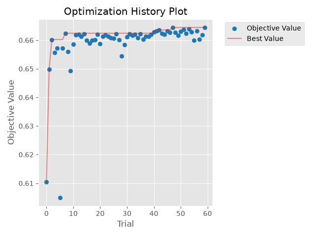
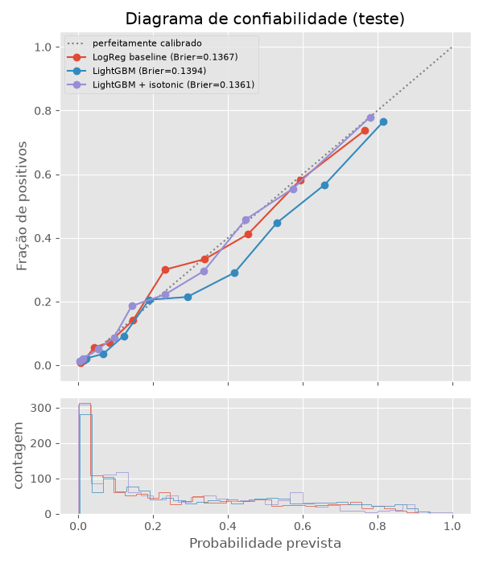
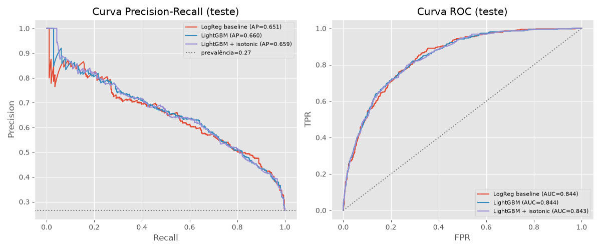
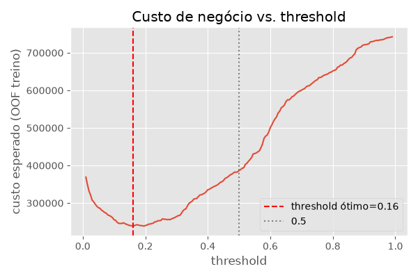
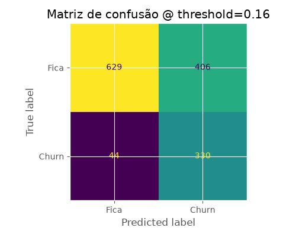
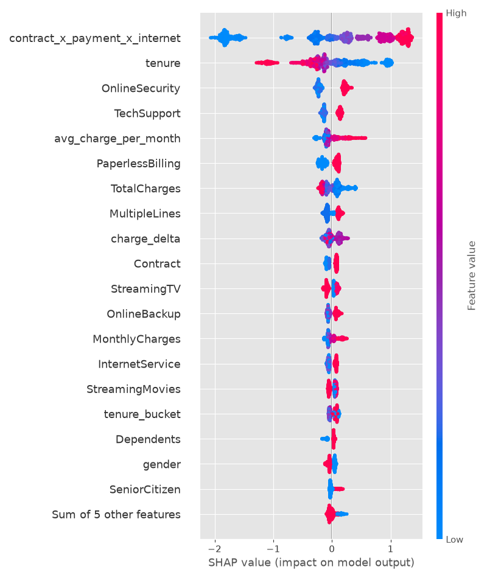

# 02 · Previsão de churn com calibração (Telco)

**Script:** `p02_churn/train.py` · **Experimento:** `02_ensemble_telco_churn` · **Run:** `09a557af…` ·
**Modelo:** `telco_churn_lgbm_calibrated@champion`

## Objetivo

Estimar a **probabilidade** de cancelamento de cada cliente, com probabilidades calibradas (para uso em
decisões financeiras) e um ponto de corte que minimize o custo de negócio.

## Dados

Kaggle `blastchar/telco-customer-churn`: **7.043 clientes**, taxa de churn de **26,5%**.

- `TotalCharges` vem como texto, com 11 valores em branco, todos de clientes com `tenure = 0`. Eles
  ainda não foram cobrados, então o branco vira **0** (não é faltante aleatório).
- `customerID` é descartado.

### Features derivadas

| Feature | Definição | Intuição |
|---|---|---|
| `n_services` | nº de serviços contratados ("Yes") | engajamento |
| `avg_charge_per_month` | `TotalCharges / max(tenure, 1)` | gasto médio histórico |
| `charge_delta` | `MonthlyCharges − avg_charge_per_month` | aumento recente de preço |
| `tenure_bucket` | faixas 0-6, 7-12, 13-24, 25-48, 49+ | não linearidade do tempo de casa |
| `contract_x_payment_x_internet` | concatenação das 3 categorias (36 níveis) | interação de alta cardinalidade |

## Pipeline

1. **Holdout estratificado**: 80% treino (5.634) / 20% teste (1.409, com 374 churners).
2. **`TargetEncoder` do sklearn dentro do `Pipeline`** para todas as categóricas. Ele faz *cross-fitting*
   interno (5 folds estratificados) no `fit_transform`, e como o `Pipeline` inteiro é re-ajustado em
   cada fold da validação cruzada, **não há vazamento de alvo**.
3. **Baseline**: regressão logística com one-hot + padronização.
4. **Optuna** (TPE, 60 trials) maximizando **PR-AUC** em CV estratificada de 5 folds. Espaço de busca:
   `n_estimators`, `learning_rate`, `num_leaves`, `max_depth`, `min_child_samples`, `subsample`,
   `colsample_bytree`, `reg_alpha`, `reg_lambda` e `scale_pos_weight` (1–4). Cada trial é um run aninhado.
5. **Calibração** `CalibratedClassifierCV` sigmoide vs. isotônica, escolhida pelo **Brier em predições
   out-of-fold do treino** (o teste não participa da escolha).
6. **Threshold de negócio**: minimiza `custo = 500 × FN + 100 × FP` nas predições OOF do treino; só depois
   é aplicado no teste.
7. **SHAP** (`TreeExplainer`) no LightGBM não calibrado (a calibração é monotônica e não muda a ordem).
8. Registro do modelo calibrado (sklearn) + booster nativo do LightGBM (`native_model/lgbm_booster.txt`).

## Otimização

- CV PR-AUC dos 60 trials: de 0,605 a **0,664** (melhor: trial 47).

| Hiperparâmetro | Valor |
|---|---|
| `n_estimators` | 813 |
| `learning_rate` | 0,0195 |
| `num_leaves` | **4** |
| `max_depth` | 9 (irrelevante com 4 folhas) |
| `min_child_samples` | 93 |
| `subsample` / `colsample_bytree` | 0,876 / 0,926 |
| `reg_alpha` / `reg_lambda` | ≈ 0 / ≈ 0 |
| `scale_pos_weight` | 1,38 |

O Optuna escolheu **árvores de 4 folhas**, quase "tocos": o sinal deste dataset é pouco não linear. Isso
explica por que a regressão logística chega tão perto (abaixo).



## Resultados no teste (1.409 clientes)

| Modelo | PR-AUC | ROC-AUC | Brier | Log-loss | ECE |
|---|---|---|---|---|---|
| Regressão logística (baseline) | 0,651 | **0,844** | 0,137 | **0,418** | **0,017** |
| LightGBM (sem calibrar) | 0,660 | 0,844 | 0,139 | 0,426 | 0,049 |
| **LightGBM + isotônica** (champion) | **0,659** | 0,843 | **0,136** | 0,419 | 0,022 |

- **O LightGBM ganha pouco da regressão logística:** +0,009 de PR-AUC, ROC-AUC igual, e a logística é
  até melhor calibrada. Para um modelo em produção, a logística é uma alternativa legítima (mais simples
  e explicável).
- A calibração isotônica foi escolhida por diferença mínima (Brier OOF 0,1339 vs. 0,1340 da sigmoide).
  Ela **corrigiu o viés** do LightGBM, que superestimava as probabilidades por causa do `scale_pos_weight`:
  ECE de 0,049 → 0,022.





## Decisão de negócio

Custos assumidos: **perder um cliente (FN) = 500**, **oferta de retenção desnecessária (FP) = 100**.



Threshold ótimo (OOF do treino): **0,16**. No teste:

| | Previsto: churn | Previsto: fica |
|---|---|---|
| **Real: churn (374)** | TP = 330 | FN = 44 |
| **Real: fica (1.035)** | FP = 406 | TN = 629 |

Recall de **88%**, precisão de 45%.

| Estratégia | Custo no teste |
|---|---|
| Não fazer nada (perde os 374) | 187.000 |
| Oferta para todos (1.035 FP) | 103.500 |
| **Modelo @ 0,16** | **62.600** |

**Economia de 40.900 (−40%)** contra a melhor estratégia sem modelo. O threshold é baixo porque um FN
custa 5× um FP. O F1-macro nesse ponto é 0,666 (seria 0,719 com o corte em 0,5), mas o F1 não reflete
o custo assimétrico.

> **Simplificação:** o custo supõe que a oferta sempre retém quem ia sair (TP custa 0) e que o FP custa
> só a oferta. Com taxas reais de aceitação e o valor do cliente (CLV), basta trocar `--cost-fn` e
> `--cost-fp`.



## Explicabilidade (SHAP)



| Feature | \|SHAP\| médio |
|---|---|
| `contract_x_payment_x_internet` | 0,904 |
| `tenure` | 0,386 |
| `OnlineSecurity` | 0,224 |
| `TechSupport` | 0,140 |
| `avg_charge_per_month` | 0,123 |
| `PaperlessBilling` | 0,119 |
| `TotalCharges` | 0,118 |

**Como ler as categóricas:** com target encoding, o "valor da feature" (cor) de uma categórica é a taxa de
churn histórica da categoria. Vermelho = categoria com mais churn histórico.

- A interação **contrato × forma de pagamento × internet** domina. A combinação de maior risco é contrato
  mensal + *Electronic check* + fibra óptica: **60% de churn** em 1.307 clientes (média geral: 26,5%).
- **Tempo de casa** baixo aumenta muito o risco; clientes antigos quase não saem.
- Não ter segurança online ou suporte técnico aumenta o risco: churn de 41,8% sem `OnlineSecurity` vs.
  14,6% com; 41,6% sem `TechSupport` vs. 15,2% com.
- `SeniorCitizen` e `gender` têm efeito pequeno.

Também no MLflow: `shap/global_importance_bar.png` e `shap/local_waterfall_highest_risk.png`
(explicação do cliente de maior risco no teste).

## Artefatos

| No MLflow | Exportado em `docs/assets/p02/` |
|---|---|
| `plots/pr_roc_curves.png`, `reliability_diagram.png`, `business_cost_curve.png`, `confusion_matrix_business_threshold.png` | `plots__*.png` |
| `shap/*.png`, `shap/mean_abs_shap.csv` | `shap__*` |
| `optuna/trials.csv`, `optimization_history.png`, `param_importances.png` | `optuna__*` |
| `native_model/lgbm_booster.txt` (booster), `metadata.json` (params, threshold, ordem das features) | só `metadata.json` |
| 60 runs aninhados `optuna_trial_XXX` + `baseline_logreg` | `runs.json` |

**ONNX não foi gerado:** o `skl2onnx` não tem conversor para `TargetEncoder` +
`CalibratedClassifierCV`. O booster nativo do LightGBM está salvo.

## Como reproduzir

```powershell
python -m p02_churn.train --n-trials 60 --cost-fn 500 --cost-fp 100
```
