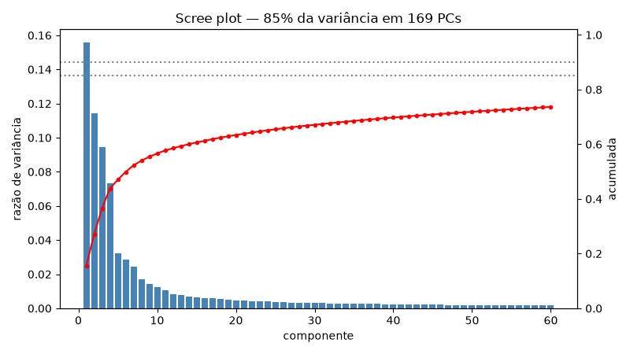
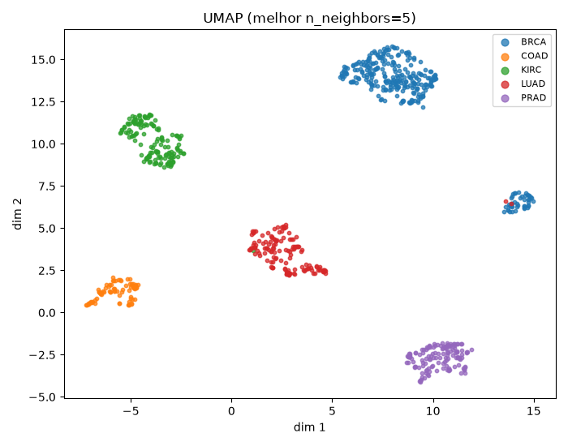
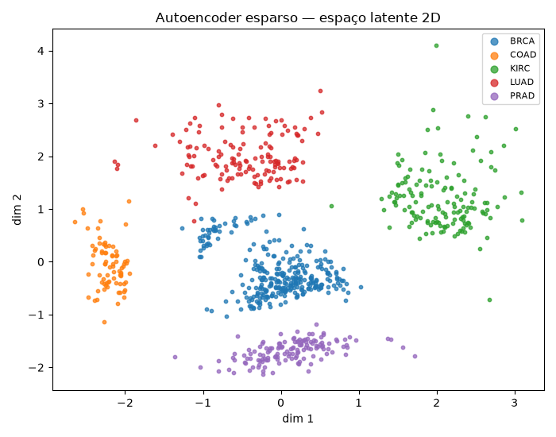
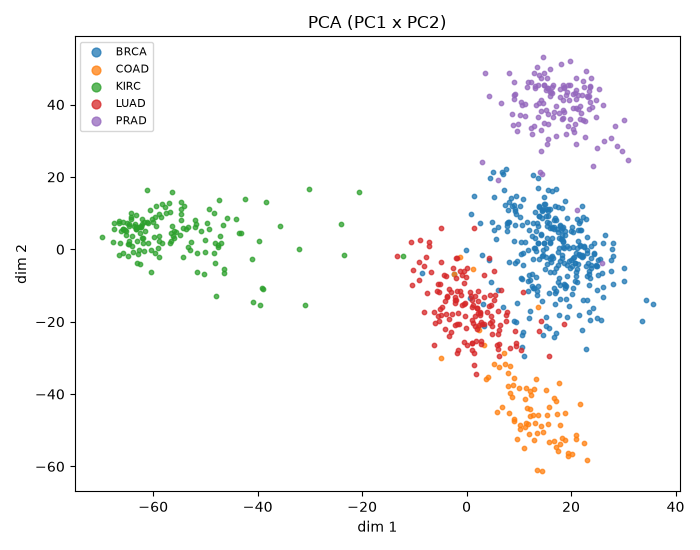
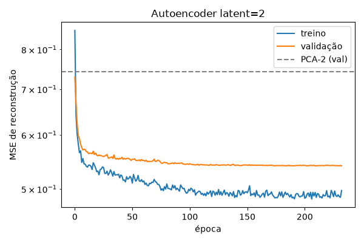

# 03 · Redução de dimensionalidade em genômica (p ≫ n)

**Script:** `p03_dimred/train.py` · **Experimento:** `03_dimred_gene_expression` · **Run:** `4a9b3de1…` ·
**Modelos:** `gene_expression_pca_umap@champion`, `gene_expression_sparse_ae_latent2@champion`,
`gene_expression_sparse_ae_latent10@champion`

## Objetivo

Comprimir mais de 20 mil genes por paciente num espaço pequeno que preserve tanto a **variância global**
quanto a **vizinhança local**, e comparar uma projeção linear (PCA), uma não linear sobre o PCA (UMAP) e
um Autoencoder não linear com regularização esparsa.

## Dados

**TCGA PANCAN (UCI, dataset 401)**: **801 pacientes × 20.531 genes**, 5 tipos de tumor:

| Tumor | Pacientes |
|---|---|
| BRCA (mama) | 300 |
| KIRC (rim) | 146 |
| LUAD (pulmão) | 141 |
| PRAD (próstata) | 136 |
| COAD (cólon) | 78 |

Razão p/n ≈ 25,6.

> **Divergência com o enunciado:** o link `crawford/gene-expression` do Kaggle é outro dataset (leucemia
> de Golub: 72 amostras × 7.129 genes, microarray). O descrito no projeto (>20 mil genes, centenas de
> pacientes, tipos de tumor) é o TCGA PANCAN, baixado da UCI. O loader aceita os dois formatos
> (`python data/download_data.py gene_golub` baixa o Golub).

## Pipeline

Divisão estratificada 80/20 (640 treino / 161 validação). **Tudo é ajustado só no treino.**

1. **Normalização automática.** Detecta contagens brutas (→ log-CPM), microarray com negativos (→ clip
   20–16.000 + log2) ou dados já em escala log (→ nada). O PANCAN já vem normalizado (valores de 0 a
   20,8), então ficou `none`. Aplicar log-CPM aqui seria um erro (normalizaria duas vezes).
2. **Filtro de genes:** remove 571 genes com variância ≤ 0,01 e mantém os **5.000 mais variáveis**.
3. `StandardScaler`.
4. **PCA completo**: scree plot, componentes necessários para 85/90/95% da variância, MSE de
   reconstrução na validação.
5. **UMAP sobre PCA-50**, com varredura de `n_neighbors` ∈ {5, 15, 50} (runs aninhados). Escolha pela
   trustworthiness.
6. **Autoencoder esparso (PyTorch)** com latente de 2 e de 10 dimensões:
   - encoder 5000 → 512 → 128 → latente; decoder espelhado; BatchNorm + GELU + Dropout 0,1;
   - perda = MSE + **1e-3 × L1 nas ativações latentes** (esparsidade); AdamW (weight decay 1e-4);
   - ReduceLROnPlateau; early stopping na validação (paciência 30, máximo 400 épocas).
7. **Comparação na mesma dimensão** (PCA-2 × AE-2 e PCA-10 × AE-10) por MSE de reconstrução na
   validação e qualidade do embedding.

### Métricas de qualidade do embedding

| Métrica | Mede | Melhor |
|---|---|---|
| **Trustworthiness** (k=10) | Se vizinhos no embedding também eram vizinhos no espaço original | → 1 |
| **kNN accuracy** (5-NN, CV 5 folds) | Se o tipo de tumor é recuperável pelos vizinhos no embedding | → 1 |
| **Silhueta por rótulo** | Quão separados ficam os tumores | → 1 |
| **MSE de reconstrução** (validação, escala padronizada) | Informação perdida na compressão | → 0 |

## Resultados

### PCA



| Variância explicada | Componentes |
|---|---|
| 85% | **169** |
| 90% | 253 |
| 95% | 381 |

**O enunciado previa ~50 componentes para 85% da variância; foram necessários 169.** Com 50 PCs fica
um MSE de reconstrução de 0,362 na validação (escala padronizada, onde 1,0 = não reconstruir nada).
A variância está bem espalhada: o sinal de tipo de tumor é forte, mas há muita variação individual.

### Comparação dos métodos

| Método | Dim. | MSE recon. (val) | Trustworthiness | kNN acc. | Silhueta |
|---|---|---|---|---|---|
| PCA | 2 | 0,742 | 0,905 | 0,945 | 0,516 |
| **UMAP** (sobre PCA-50, nn=5) | 2 | — | **0,960** | **0,996** | **0,756** |
| Autoencoder esparso | 2 | **0,540** | 0,954 | 0,996 | 0,574 |
| PCA | 10 | 0,475 | 0,980 | 0,996 | 0,454 |
| Autoencoder esparso | 10 | **0,436** | **0,988** | 0,996 | 0,318 |

1. **Em 2D, o Autoencoder reconstrói muito melhor que o PCA** (0,54 vs. 0,74, −27%): a estrutura não
   linear captura mais informação no mesmo gargalo.
2. **Em 10D, a vantagem do AE é pequena** (0,436 vs. 0,475, −8%). Com mais dimensões o PCA já
   captura boa parte do que importa.
3. **Para visualização, o UMAP é o melhor**: maior trustworthiness e silhueta. Mas o UMAP **não
   reconstrói**; ele só preserva vizinhanças.
4. Todos (exceto PCA-2) separam os 5 tumores quase perfeitamente: 99,6% de acerto com 5-NN.
5. A silhueta cai com a dimensão (AE-10: 0,32) porque em mais dimensões cabe a variação **dentro** de
   cada tumor. Isso não é perda de qualidade.

### Visualizações



O BRCA aparece em **dois agrupamentos** no UMAP (o principal e uma "ilha" menor, com alguns pontos de
LUAD). Isso é consistente com subtipos moleculares conhecidos do câncer de mama, mas **é uma hipótese**:
os dados não trazem anotação de subtipo para confirmar.



O latente 2D do Autoencoder também separa os 5 tumores, com grupos mais "espalhados" que no UMAP (o AE
otimiza reconstrução, não vizinhança). As duas unidades latentes ficaram ativas (a penalidade L1 não
zerou nenhuma).



No PCA 2D, KIRC (isolado à esquerda) e PRAD (no topo) se separam bem; COAD encosta no LUAD, e BRCA e
LUAD se sobrepõem parcialmente. É por isso que o kNN cai para 94,5% só no PCA-2.

### Varredura do UMAP

| `n_neighbors` | Trustworthiness | kNN acc. | Silhueta |
|---|---|---|---|
| **5** (escolhido) | **0,960** | 0,996 | 0,756 |
| 15 | 0,953 | 0,995 | **0,829** |
| 50 | 0,946 | 0,995 | 0,819 |

Valores menores de `n_neighbors` preservam melhor a estrutura local (trustworthiness); maiores formam
grupos mais compactos (silhueta). O critério escolhido foi trustworthiness, alinhado ao objetivo de
"não distorcer vizinhanças".

### Treino do Autoencoder



| Latente | Épocas até parar | Tempo |
|---|---|---|
| 2 | 233 | 139 s |
| 10 | 82 | 56 s |

A linha tracejada no gráfico é o MSE do PCA na mesma dimensão: o AE passa abaixo dela já nas primeiras
épocas. Há uma diferença de ~0,05 entre treino (≈0,49) e validação (≈0,54), um sobreajuste leve e
esperado com 640 amostras e 5.000 genes; o early stopping usa a validação. As curvas por época estão no
MLflow (*Model metrics* dos runs `sparse_autoencoder_latent*`).

## Artefatos

| No MLflow | Exportado em `docs/assets/p03/` |
|---|---|
| `plots/pca_scree.png`, `pca_2d.png`, `umap_2d_best.png` | `plots__*.png` |
| `interactive/pca_2d.html`, `umap_2d.html`, `ae_latent_2d.html` — Plotly interativo | só no MLflow (~4 MB cada) |
| `tables/method_comparison.csv`, `class_counts.csv`, `selected_genes.csv` | `tables__*.csv` |
| runs `umap_nn{5,15,50}` (gráfico de cada) | `umap_nn*__plots__umap_2d.png` |
| runs `sparse_autoencoder_latent{2,10}`: curvas, latente, `full_autoencoder/autoencoder_state_dict.pt` | PNGs |

### Modelos registrados

- `gene_expression_pca_umap`: `Pipeline` StandardScaler → PCA-50 → UMAP. Use `.transform()`, não
  `.predict()` (por isso não há sabor pyfunc). Recebe os 5.000 genes de `selected_genes.csv`, na mesma
  ordem.
- `gene_expression_sparse_ae_latent{2,10}`: o **encoder** (genes padronizados → latente) como
  `nn.Sequential` puro do PyTorch. O AE completo (com decoder, para reconstrução) está em
  `full_autoencoder/autoencoder_state_dict.pt`.

## Como reproduzir

```powershell
python -m p03_dimred.train
python -m p03_dimred.train --latent-dims 2 10 32 --ae-l1 1e-2      # exemplo de variação
```
