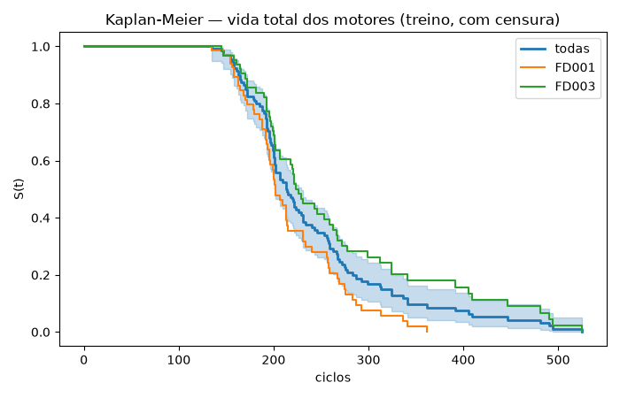
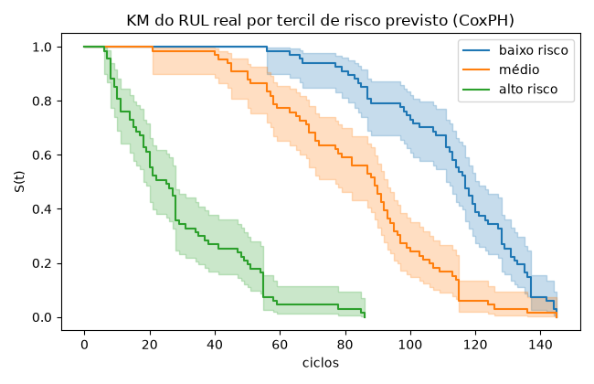
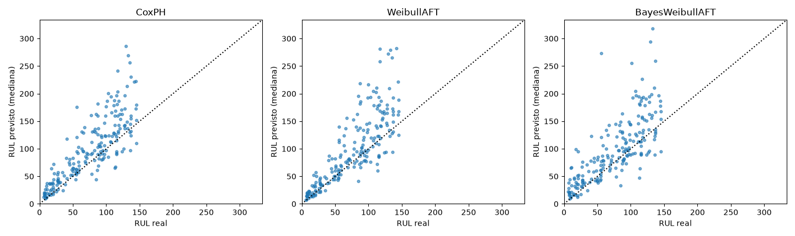
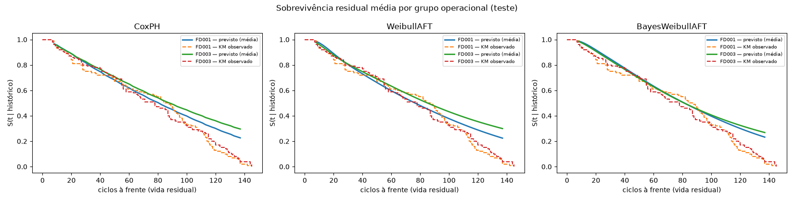
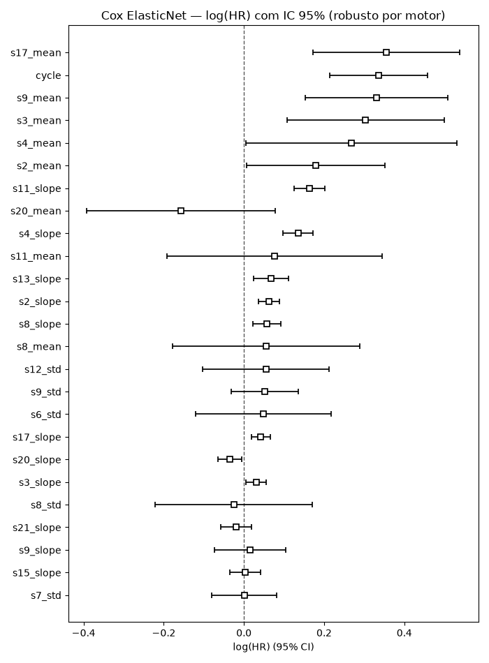
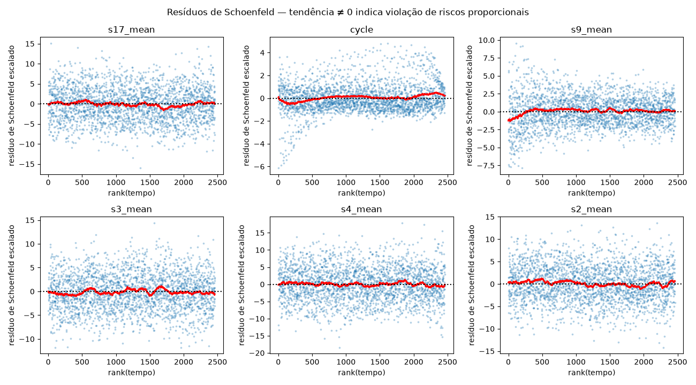
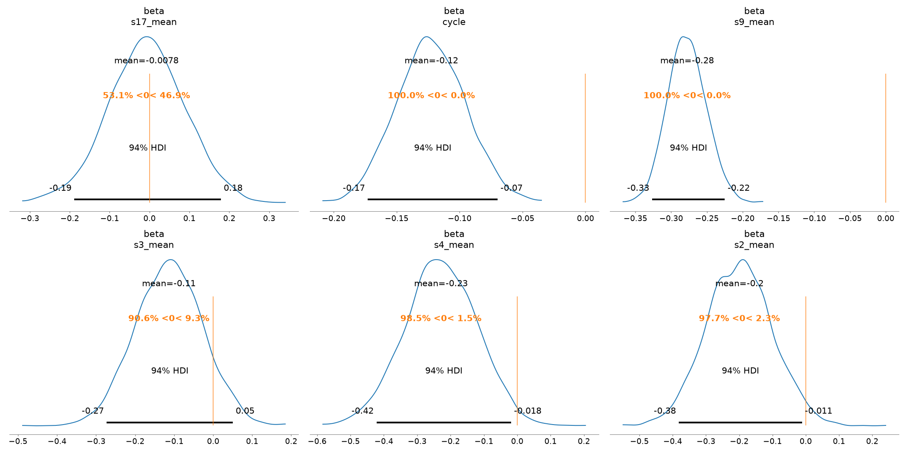

# 04 · Confiabilidade e tempo até a falha (NASA C-MAPSS)

**Script:** `p04_survival/train.py` · **Experimento:** `04_survival_turbofan_rul` · **Run:** `5522955c…` ·
**Modelo:** `turbofan_rul_survival@champion`

## Objetivo

Estimar a vida útil remanescente (**RUL**) de motores turbofan e o risco de falha condicionado ao
histórico de degradação, com tratamento correto de **censura à direita** e intervalos de credibilidade.

## Dados

Kaggle `behrad3d/nasa-cmaps` (simulação C-MAPSS da NASA). Subsets usados: **FD001 + FD003**.

| | FD001 | FD003 |
|---|---|---|
| Condições de operação | 1 | 1 |
| Modos de falha | 1 (HPC) | 2 (HPC + fan) |
| Motores de treino / teste | 100 / 100 | 100 / 100 |

- **Treino:** cada motor roda do ciclo 1 até a falha (3 settings de operação + 21 sensores por ciclo).
- **Teste:** trajetórias truncadas antes da falha; `RUL_FDxxx.txt` dá o RUL real no último ciclo.
- 16 sensores informativos. Os constantes são descartados automaticamente, pelo desvio-padrão dentro de
  cada regime de operação.

Usar dois subsets transforma "frota" (FD001 vs. FD003) num grupo para o modelo hierárquico. O script
também aceita FD002/FD004 (6 regimes, com normalização dos sensores por regime).

## Formulação: landmarking

Em vez de prever o RUL a partir de uma linha isolada, cada **snapshot** de um motor no ciclo *t* vira uma
observação:

- **covariáveis:** média, desvio-padrão e inclinação (tendência linear) de cada sensor numa janela móvel
  de 15 ciclos até *t*, mais o próprio *t* (idade). São 49 features;
- **alvo:** vida residual (falha − *t*), com indicador de evento.

Snapshots a cada 10 ciclos (`--stride`), a partir do ciclo 15: **3.072 snapshots de treino**.

### Censura e divisão

- 160 motores de treino, 40 de **validação** (divisão **por motor**: snapshots do mesmo motor nunca ficam
  em lados diferentes) e os 200 de **teste** oficiais.
- **30% dos motores de treino têm a trajetória truncada** num ciclo aleatório entre 40% e 95% da vida
  (evento = 0). O C-MAPSS não tem censura no treino; ela foi induzida para que os modelos tratem o caso
  real (motores ainda em operação).
- No teste, o snapshot é o último ciclo observado e o "tempo até o evento" é o RUL real.

## Modelos

| Modelo | Biblioteca | Detalhes |
|---|---|---|
| Kaplan-Meier | lifelines | Referência não paramétrica, por frota |
| **Cox PH ElasticNet** | lifelines | Grid `penalizer` ∈ {0,01; 0,05; 0,2} × `l1_ratio` ∈ {0; 0,5; 0,9}; erro-padrão **robusto por motor** (`cluster_col`), pois snapshots do mesmo motor são correlacionados |
| Cox tempo-variante | lifelines `CoxTimeVaryingFitter` | Formato start/stop; covariáveis do intervalo (start, stop] medidas em *start* (sem olhar o futuro); penalidade reescalada |
| Weibull AFT | lifelines | `penalizer=0,01` |
| **Weibull AFT Bayesiano hierárquico** | PyMC + nutpie | Intercepto por frota com *pooling* parcial; censura via `pm.Censored` |

### Modelo Bayesiano

```
log λ_i = a[frota_i] + X_i · β          T_i ~ Weibull(forma k, escala λ_i)
a[f]    = μ_a + σ_a · z_f,   z_f ~ N(0, 1)       (parametrização não centrada)
μ_a ~ N(log mediana(T), 1,5)    σ_a ~ HalfNormal(0,5)
β ~ N(0, 0,5)                   k ~ Gamma(2, 1)
censurados: P(T > t) via pm.Censored
```

- Usa as 6 features de maior |coef| no Cox e 3 snapshots por motor (480 observações), para limitar a
  correlação entre snapshots.
- 4 cadeias × 1.000 amostras (+1.000 de tuning), `target_accept=0,95`, sampler **nutpie** (compilado via
  numba). No Windows sem g++, o NUTS puro do PyMC ficaria lento demais.

## Métricas

| Métrica | O que mede |
|---|---|
| **C-index** (Harrell) | Ordenação de risco: % de pares de motores em que quem falha antes tem risco maior |
| **Brier dinâmico (IPCW)** em t = 25, 50, 100 ciclos e **IBS** (integrado) | Calibração + discriminação da curva S(t) inteira; censura tratada por pesos inversos de probabilidade |
| **RMSE / MAE do RUL** | Erro da mediana prevista de vida residual |
| Score NASA | Penalidade assimétrica (atraso > antecipação), da competição PHM08 |
| R-hat, ESS, divergências, **WAIC, LOO-CV (PSIS)** | Diagnóstico e comparação do modelo Bayesiano |

## Resultados

### Kaplan-Meier



Vida mediana (treino, com censura): **213 ciclos**. FD003 tem cauda mais longa (motores passando de 500
ciclos) que FD001 (máximo ~360).

### Seleção do Cox (validação, 40 motores)

| penalizer \ l1_ratio | 0,0 | 0,5 | 0,9 |
|---|---|---|---|
| 0,01 | 0,8717 (47 coefs) | 0,8729 (39) | 0,8737 (38) |
| **0,05** | 0,8738 (48) | 0,8785 (32) | **0,8794 (24)** |
| 0,2 | 0,8762 (49) | 0,8782 (15) | 0,8725 (8) |

Escolhido: `penalizer=0,05`, `l1_ratio=0,9` (24 coeficientes não nulos). A grade toda fica entre 0,872 e
0,879: o resultado é pouco sensível à regularização.

### Comparação no teste (200 motores)

| Modelo | C-index | IBS | Brier t=50 | RMSE RUL | MAE RUL | C-index (val) |
|---|---|---|---|---|---|---|
| **Cox ElasticNet** (champion) | 0,840 | 0,098 | 0,067 | **41,0** | **28,9** | **0,879** |
| Weibull AFT | **0,843** | **0,091** | **0,053** | 44,8 | 29,5 | 0,870 |
| AFT Bayesiano hierárquico | 0,818 | 0,107 | 0,087 | 44,7 | 30,6 | — |
| Cox tempo-variante | 0,814 | — | — | — | — | — |

- **Cox e Weibull AFT empatam na prática.** O AFT é um pouco melhor em C-index e Brier, o Cox em RUL.
  O registrado foi o Cox, pelo critério pré-definido (C-index de **validação**).
- O Bayesiano fica um pouco atrás porque usa só 6 features e 480 observações, contra 49 features e 3.072
  no Cox. Em troca, ele dá incerteza completa (abaixo).
- O Cox tempo-variante serve para inferência e ordenação de risco, não para prever RUL (ver "Limitações").

### Ordenação de risco



Dividindo os 200 motores de teste em tercis de risco previsto pelo Cox, as curvas de RUL **real** ficam
bem separadas: a vida residual mediana é de ~20 ciclos no tercil de alto risco, ~85 no médio e ~120 no
de baixo risco.

### Erro do RUL por faixa



Modelo champion (Cox), por faixa de RUL real:

| RUL real | Motores | RMSE | MAE | Viés médio |
|---|---|---|---|---|
| ≤ 25 | 35 | 17,7 | 13,0 | **+12,6** |
| 26–50 | 27 | 24,4 | 18,6 | +17,4 |
| 51–75 | 30 | 37,8 | 26,1 | +25,3 |
| > 75 | 108 | 49,6 | 37,5 | +28,1 |

1. **O erro cresce com o RUL.** Motores ainda saudáveis têm pouca degradação visível nos sensores, então
   é difícil dizer se faltam 80 ou 150 ciclos. Perto do fim, a previsão é bem mais precisa.
2. **O viés é positivo em todas as faixas: o modelo superestima a vida restante.** Em manutenção esse é
   o lado perigoso do erro (manutenção tardia). Mesmo com RUL ≤ 25, a previsão fica em média 12,6
   ciclos acima. **Para decidir manutenção, use um quantil inferior da distribuição** (ex.: o tempo em
   que S(t) = 0,8 ou 0,9), não a mediana.
3. O score NASA ficou muito alto (~8 × 10⁶) pelo mesmo motivo: ele pune exponencialmente as
   superestimações grandes. A literatura com RMSE de 12–20 ciclos **limita o RUL alvo em 125–130** e
   usa modelos de regressão direta; os números não são comparáveis.

### Curvas de sobrevivência por frota



As curvas previstas (médias por frota) seguem o Kaplan-Meier observado até ~80 ciclos à frente. Depois
disso os três modelos **superestimam a sobrevivência**: preveem S ≈ 0,22–0,30 em 140 ciclos, quando o
observado é ≈ 0. É o mesmo viés otimista da tabela anterior, visto pela curva inteira.

### Hazard ratios (Cox champion)

| Covariável | coef | HR | p |
|---|---|---|---|
| `s17_mean` | 0,356 | 1,43 | 0,0001 |
| `cycle` (idade) | 0,336 | 1,40 | < 0,0001 |
| `s9_mean` | 0,331 | 1,39 | 0,0003 |
| `s3_mean` | 0,304 | 1,35 | 0,002 |
| `s4_mean` | 0,268 | 1,31 | 0,046 |
| `s2_mean` | 0,179 | 1,20 | 0,042 |
| `s11_slope` | 0,164 | 1,18 | < 0,0001 |

HR por desvio-padrão da feature (as features são padronizadas). Ex.: +1 DP na média móvel do sensor 17
multiplica o risco instantâneo de falha por 1,43, mantidas as demais. O que mais pesa é o **nível** dos
sensores de degradação, junto com a idade.



### Diagnóstico de riscos proporcionais (Schoenfeld)



- O teste formal (`time_transform="rank"`) rejeita a proporcionalidade (p < 0,05) em **24 das 49
  covariáveis**. As piores são as **inclinações** (`s11_slope`, `s4_slope`, `s3_slope`, `s8_slope`).
- Nos gráficos das covariáveis mais importantes, a tendência suavizada (vermelho) fica quase plana em
  torno de 0. A exceção é `cycle` (e um pouco `s9_mean`) no início do eixo de tempo.
- **Leitura:** com ~2.450 eventos (snapshots), o teste detecta desvios minúsculos. Os efeitos relevantes
  (níveis dos sensores) são aproximadamente proporcionais. A violação real está nas **tendências**: o
  efeito da velocidade de degradação muda ao longo da vida residual. Remédios possíveis: estratificar
  por faixa de idade, interação covariável × tempo, ou preferir o AFT, que não assume riscos proporcionais
  (e teve desempenho igual).

### Cox tempo-variante

| Covariável | coef | HR | p |
|---|---|---|---|
| `s11_mean` | 2,578 | 13,2 | 0,0003 |
| `s4_mean` | 1,170 | 3,22 | 0,097 |
| `s13_slope` | 0,494 | 1,64 | 0,047 |

Aqui o risco é comparado entre motores **da mesma idade** (o eixo de tempo é o ciclo), então os HR
medem o efeito do estado atual de degradação "a idade igual". O sensor 11 domina: +1 DP no nível atual
multiplica o risco por ~13. C-index de 0,814 no teste, ordenando pelo risco parcial no último ciclo.

### Modelo Bayesiano

| Diagnóstico | Valor | Leitura |
|---|---|---|
| R-hat máximo | 1,01 | Convergiu (< 1,01–1,05) |
| ESS bulk mínimo | 642 | Suficiente |
| Divergências | 7 de 4.000 | Poucas, mas não zero (ver abaixo) |
| ELPD-LOO / p_loo | −1.737,9 / 8,4 | ~8 parâmetros efetivos (11 nominais) |
| Pareto k máximo | 0,50 | < 0,7: estimativa PSIS-LOO confiável |
| WAIC | 3.475,7 | Igual ao LOOIC (3.475,8) |

Posterior (média e HDI 94%):

| Parâmetro | Média | HDI 94% |
|---|---|---|
| β `s9_mean` | −0,278 | [−0,327; −0,225] |
| β `s4_mean` | −0,229 | [−0,422; −0,018] |
| β `s2_mean` | −0,199 | [−0,382; −0,011] |
| β `cycle` | −0,122 | [−0,173; −0,070] |
| β `s3_mean` | −0,113 | [−0,273; 0,050] |
| β `s17_mean` | −0,008 | [−0,188; 0,179] |
| forma Weibull k | 2,53 | [2,32; 2,72] |
| a[FD001] | 4,797 | [4,736; 4,864] |
| a[FD003] | 4,721 | [4,659; 4,776] |
| σ_a (entre frotas) | 0,22 | [0,00; 0,63] |



- No AFT, β < 0 significa **vida residual menor**. Sensores 9, 4, 2 e a idade encurtam a vida com HDI
  inteiramente abaixo de zero.
- **`s17_mean` e `s3_mean` têm HDI cruzando zero**, apesar de significativos no Cox (s17: p = 0,0001).
  Com só 6 features colineares e 480 observações, o efeito fica dividido com `s9`/`s4`; no Cox, com 49
  features e 3.072 snapshots, o efeito aparece isolado. É a diferença entre "preditivo junto com os
  outros" e "identificável sozinho".
- **k = 2,53 > 1**: risco crescente com o tempo (desgaste), como esperado em falhas mecânicas. O Weibull
  AFT do lifelines estimou ρ = 2,71, consistente.
- **Frotas:** dadas as covariáveis, FD003 tem vida residual ~7% menor que FD001 (e^(4,721−4,797) ≈ 0,93).
  No Kaplan-Meier bruto o FD003 vive **mais**; a diferença é que aqui a comparação é a mesma degradação
  observada.
- **σ_a é mal identificado** (HDI de 0 a 0,63): com só 2 frotas não há como estimar bem a variação entre
  grupos. Esta também é a causa provável das 7 divergências (geometria de "funil"). Com FD001–FD004
  (4 frotas) o pooling parcial ficaria mais informativo.

Também no MLflow: `plots/bayes_forest_hdi.png`, `plots/bayes_trace.png` e o posterior completo em
`posterior/idata.nc` (ArviZ/NetCDF, para reanálise sem resamplear).

## Limitações

- **Cox tempo-variante não prevê RUL.** As covariáveis são *internas* (o próprio desgaste) e crescem com
  o tempo; prever exigiria projetar a trajetória delas (*joint model*). Congelar no último valor
  subestima o risco futuro: no teste com dados sintéticos isso deu RMSE de ~430 ciclos. Por isso ele é
  avaliado só por C-index.
- **Penalidade do `CoxTimeVaryingFitter` reescalada.** O lifelines multiplica a penalidade pelo nº de
  linhas; no formato start/stop há ~20 intervalos por motor e no máximo 1 evento, então a mesma
  `penalizer` do Cox de snapshots encolhia todos os β para ~0 (C-index de 0,36 nos testes sintéticos).
  Foi reescalada por eventos/linhas.
- **Snapshots do mesmo motor são correlacionados.** Isso é tratado com erro-padrão robusto no Cox; no
  Bayesiano limitamos a 3 snapshots por motor, e WAIC/LOO são aproximações (o LOO deixa de fora um
  snapshot, não um motor).
- **Censura induzida.** A censura do treino foi gerada artificialmente (30%); em dados de campo o mecanismo
  pode ser informativo (ex.: motores retirados por suspeita).

## Artefatos

| No MLflow | Exportado em `docs/assets/p04/` |
|---|---|
| Run pai: `plots/` (KM, curvas por grupo, tercis de risco, RUL), `tables/model_comparison.csv` | `plots__*`, `tables__*` |
| `coxph_best`: coeficientes, Schoenfeld (gráfico + teste), `coxph_summary.csv` | `coxph_best__*` |
| `cox_time_varying`: `cox_time_varying_summary.csv` | idem |
| `weibull_aft`: `weibull_aft_summary.csv` | idem |
| `bayesian_weibull_aft_pymc`: posterior, forest, trace, `bayes_posterior_summary_hdi94.csv`, `posterior/idata.nc` | PNGs + CSV |
| 9 runs `coxph_pen*_l1*` do grid | `runs.json` |

O modelo registrado é um `pyfunc` que recebe as **features de snapshot** (49 colunas, não padronizadas) e
devolve `rul_median` e `partial_hazard`. A engenharia de features a partir dos ciclos brutos
(`rolling_features`) fica no script.

## Como reproduzir

```powershell
python -m p04_survival.train --subsets FD001 FD003
python -m p04_survival.train --subsets FD001 FD002 FD003 FD004     # 4 frotas, 6 regimes
python -m p04_survival.train --no-bayes                            # sem PyMC (mais rápido)
```
