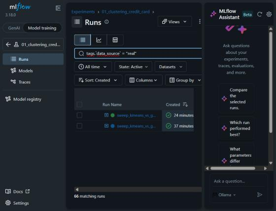

# 05 · Guia do MLflow — como enxergar o que está acontecendo

## 1. Subir o servidor

Num terminal PowerShell, na pasta do projeto (deixe essa janela aberta enquanto usa):

```powershell
.\scripts\start_mlflow.ps1
```

O script roda:

```
mlflow server --backend-store-uri sqlite:///mlflow.db --artifacts-destination ./mlartifacts
              --host 127.0.0.1 --port 5000 --workers 1
```

| Opção | Por quê |
|---|---|
| `--backend-store-uri sqlite:///mlflow.db` | Metadados (runs, parâmetros, métricas, registry) num banco SQLite, que permite buscas e Model Registry |
| `--artifacts-destination ./mlartifacts` | O servidor recebe e guarda os artefatos (proxy). Com `--default-artifact-root ./mlruns`, cada script gravaria relativo à **sua** pasta atual |
| `--workers 1` | Com SQLite, os 4 workers padrão disputam o lock de escrita; nos testes, requests ficaram pendurados por 120 s |

Quando aparecer `Uvicorn running on http://127.0.0.1:5000`, abra **http://127.0.0.1:5000** no navegador.

## 2. Primeiro acesso: modo "Model training"

O MLflow 3 abre no modo **GenAI** (traces, prompts, avaliação de LLMs), que não tem nada destes projetos.
No canto superior esquerdo, clique em **Model training**. A barra lateral passa a mostrar *Experiments*
e *Model registry*.



## 3. Navegar pelos experimentos

**Experiments** lista os quatro experimentos. Ao abrir um deles você vê a tabela de runs:

- Cada linha é um **run pai** (uma execução do script). O **⊞** à esquerda do nome expande os **runs
  aninhados** (cada k da varredura, cada trial do Optuna, cada modelo de sobrevivência...).
- **Columns** adiciona colunas de métricas e parâmetros à tabela (por exemplo `best_silhouette_score`,
  `test_pr_auc`, `test_c_index`).
- **Sort** ordena por qualquer métrica.

### Filtrar só os runs com dados reais

Na barra de busca:

```
tags.data_source = "real"
```

Se o autocompletar abrir, tecle **Esc** e depois **Enter**. Para ver só os testes, use `"synthetic"`.

Outros filtros úteis:

```
metrics.test_pr_auc > 0.65
params.best_k = "6"
attributes.run_name LIKE "coxph%"
```

## 4. Dentro de um run

Clique no nome do run:

| Aba / seção | O que tem |
|---|---|
| **Overview** | Descrição, tags, parâmetros, métricas finais, datasets de entrada, modelos registrados |
| **Model metrics** | Gráficos das métricas. Métricas logadas por passo viram curvas: perda do Autoencoder por época (projeto 3), variância explicada por componente do PCA (projeto 3) |
| **Artifacts** | Arquivos do run: `plots/` (PNG), `tables/` (CSV), `shap/`, `optuna/`, `interactive/` (HTML), `summary.json` |

Nos artefatos, PNG e CSV aparecem direto na prévia. Os `.html` em `interactive/` do projeto 3 são
gráficos Plotly interativos (passe o mouse para ver a amostra e o tumor); clique para abrir.

## 5. Comparar runs

Marque as caixas de dois ou mais runs e clique em **Compare**. A tela mostra parâmetros lado a lado
(diferenças destacadas), métricas e gráficos de coordenadas paralelas / dispersão, ótimos para:

- trials do Optuna (projeto 2) → quais hiperparâmetros levam a maior `cv_pr_auc`;
- grid do Cox (projeto 4) → `penalizer` × `l1_ratio` × `val_c_index`;
- varredura de k (projeto 1) → `n_clusters` × `silhouette_score`.

O botão de **gráfico** (ao lado do de tabela, acima da lista de runs) mostra as métricas de todos os runs
visíveis em gráficos de barras/linhas, sem precisar entrar em cada um.

## 6. Acompanhar um run ao vivo

Os scripts registram métricas durante a execução, então dá para ver o progresso com o run rodando:

- **Projeto 2**: cada trial do Optuna aparece como run aninhado assim que termina.
- **Projeto 3**: `train_reconstruction_mse` e `val_reconstruction_mse` são logadas a cada época; abra
  o run aninhado `sparse_autoencoder_latent2` → *Model metrics* e atualize a página.
- **Projeto 1**: cada combinação (algoritmo, k) vira um run aninhado conforme é avaliada.

Runs em andamento aparecem com o status *Running*; os que falharam, *Failed*.

## 7. Model Registry

**Model registry** na barra lateral lista os modelos registrados:

| Modelo | O que faz | Entrada |
|---|---|---|
| `credit_card_segmentation` | Pré-processamento + K-Means → segmento | CSV bruto do ccdata (sem `CUST_ID`) |
| `telco_churn_lgbm_calibrated` | Probabilidade calibrada de churn | Colunas do Telco + features derivadas |
| `gene_expression_pca_umap` | Padronização → PCA-50 → UMAP 2D | Os 5.000 genes selecionados |
| `gene_expression_sparse_ae_latent2/10` | Encoder (genes → espaço latente) | Matriz padronizada dos genes selecionados |
| `turbofan_rul_survival` | RUL mediano + risco relativo | Features de snapshot (janela móvel) |

Cada modelo tem várias versões (as primeiras vieram dos testes com dados sintéticos). Use os **aliases**:

- `@champion`: versão treinada com dados reais (a que deve ser usada);
- `@k2_baseline` (só na segmentação): a solução k=2, para comparação.

Cada versão também tem a tag `data_source`.

### Carregar um modelo em Python

```python
import mlflow
mlflow.set_tracking_uri("http://127.0.0.1:5000")

churn = mlflow.pyfunc.load_model("models:/telco_churn_lgbm_calibrated@champion")
proba = churn.predict(df_clientes)            # [:, 1] = probabilidade de churn

seg = mlflow.pyfunc.load_model("models:/credit_card_segmentation@champion")
segmentos = seg.predict(df_cc_bruto)
```

Os modelos com LightGBM e UMAP são salvos em cloudpickle (o formato seguro `skops` do MLflow 3 não
suporta esses estimadores). Carregue-os só de um servidor confiável.

## 8. Problemas comuns

| Sintoma | Causa / solução |
|---|---|
| `Tracking server MLflow inacessível em http://127.0.0.1:5000` | O servidor não está rodando: execute `scripts/start_mlflow.ps1` |
| Erro `[Errno 10048] ... address ('127.0.0.1', 5000)` ao subir | Porta ocupada, geralmente por workers órfãos de um servidor encerrado à força. `Get-NetTCPConnection -LocalPort 5000` mostra o PID; encerre esses processos `python.exe` |
| Request para por 120 s e dá `ReadTimeout` | Servidor com mais de 1 worker sobre SQLite. Suba com `--workers 1` (já é o padrão do script) |
| Tela cheia de coisas de LLM/traces | Está no modo GenAI: clique em **Model training** |
| Runs de teste misturados com os reais | Filtre por `tags.data_source = "real"` |

### Recomeçar do zero

Pare o servidor e apague `mlflow.db` e a pasta `mlartifacts/`. Na próxima execução os experimentos e o
registry são recriados. Isso apaga **todo** o histórico.

### Rodar sem servidor

```powershell
$env:MLFLOW_TRACKING_URI = "sqlite:///mlflow.db"
python -m p01_clustering.train
mlflow ui --backend-store-uri sqlite:///mlflow.db   # para ver depois
```
